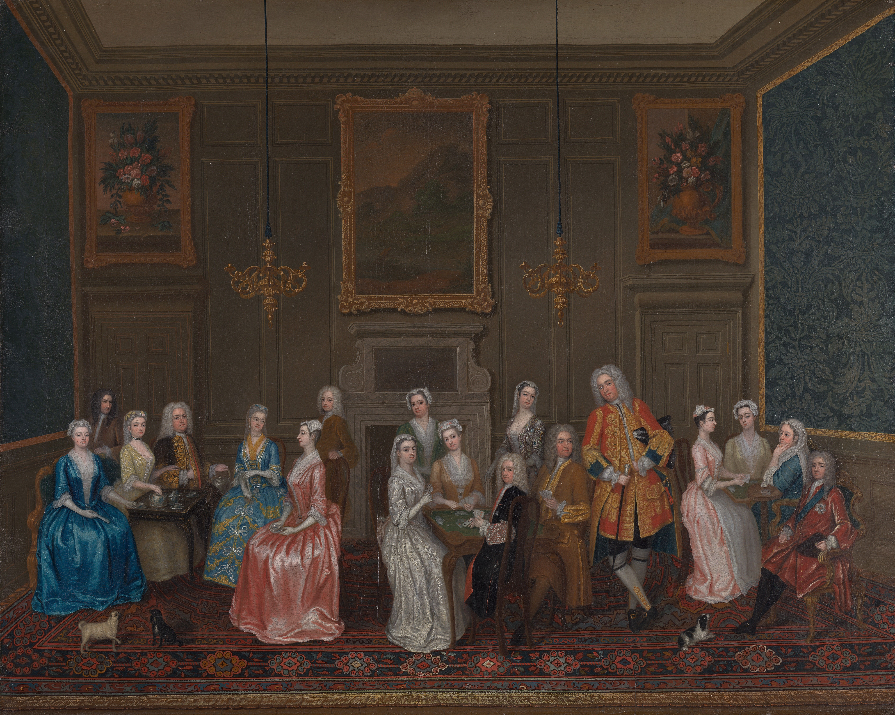
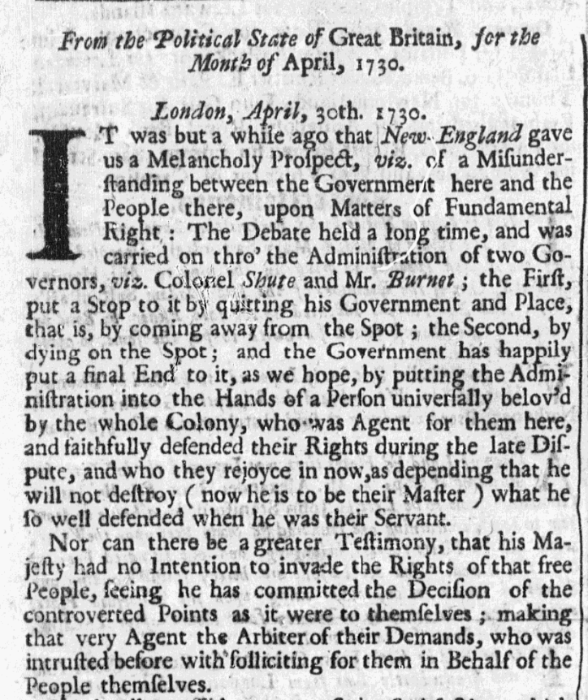
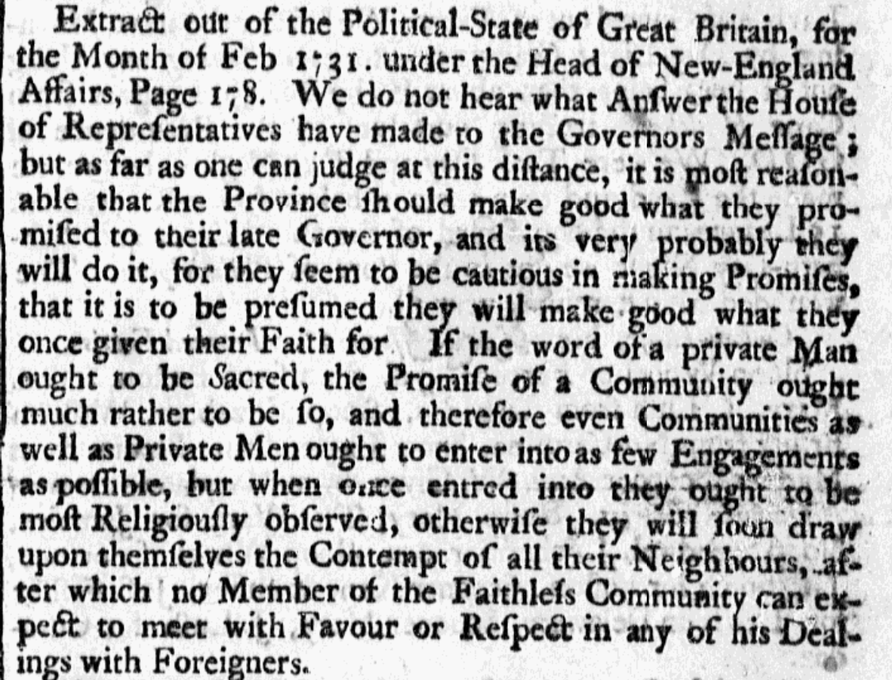
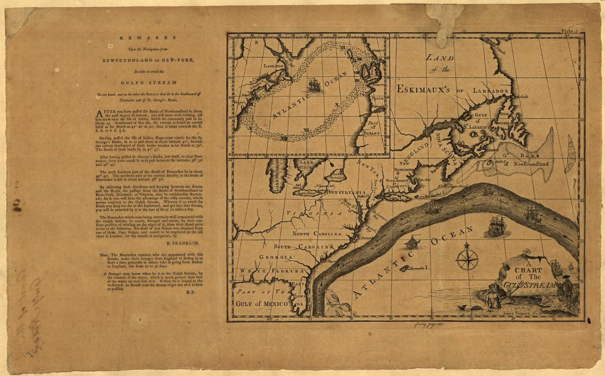

This post introduces my new digital project profiling historical newspapers.

<h1>What’s the News?</h1>

<h2>The Prints</h2>

  When I read historical newspapers, I’m almost always looking for references to a particular significant event. Frequently,
  however, I get distracted by the mundane parts of the paper.

  In the eighteenth and nineteenth centuries, newspapers often functioned more like a forum than a publication. Towns and 
  cities were smaller, and life was less anonymous. People were likely to know their local printer. Papers announced gossip 
  and weighed in on local controversies. Even when papers included news from far away, it was usually filtered through 
  personal, local sources: a letter to someone in town or a report from a ship captain or traveler.

  Lost and found notices, announcements of ship arrivals and departures, and even advertisements show the daily life of a 
  town. The least exciting parts of history can sometimes be the most interesting, because they reveal the connection between
  modern life and the lives of people in the past. 

  In the spirit of recognizing the interesting and relatable parts of daily life, I’ve decided to use this website to 
  profile issues of historical newspapers.

<h2>The Plan</h2>

  I’m planning to profile newspaper issues monthly. These issues will come from the Library of Congress’s digitized material 
  so that you can see the whole newspaper as well as my profile commentary.

  The Chronicling America collection at the Library of Congress includes hundreds of digitized newspaper titles. You can 
  access them for free and see more information about the 
  collection <a href="https://www.loc.gov/collections/chronicling-america/about-this-collection/">here</a>.

  I plan to write about one edition per newspaper, beginning with the earliest digitized title in the collection (as of this
  post, the <i>Virginia Gazette</i>). Which issue I profile will depend on which issues are available through the Library of
  Congress and which, if any, cover particularly interesting topics. Chronicling America includes newspaper editions up to 1963,
  though I plan to stop in 1875.

<h1>What Can Historic Newspapers Tell Us?</h1>

  We can learn a lot from historical newspapers. Here’s a few key things to look for:

  (Warning: all the newspaper issues discussed below are ones that I have come across while doing research, and are from the
  Readex database, not the Library of Congress.)

<h2>Whose Perspectives Mattered to Readers</h2>

  Colonial newspapers reprinted many political articles and passages of literature from other newspapers. Sometimes this was a
  matter of necessity. Other colonies’ news might become locally relevant eventually—for example, readers would want to know if 
  a neighboring colony was experiencing an outbreak of contagious illness.

  Sometimes, though, reprinting was a matter of politics or even fashion. To British North Americans, London was the center 
  of the world. They wanted to wear, read, buy, and discuss things that were relevant in 
  Britain.<a href="#fn1" id="r1">[1]</a>
    
    <figcaption>Tea drinking as a ritual that required various types of dishware was an element of British fashion that 
      British North American colonists began to emulate more commonly in the mid-eighteenth century. This 1730 painting 
      portrays tea drinking as a fashionable and elite practice.<a href="#fn2" id="r2">[2]</a></figcaption>
</figure>

  As a result, many articles in American papers were either news items from Britain or reprints of articles originally 
  published there. For example, here are two reprints of <i>The Political State of Great Britain</i>, a monthly London 
  periodical that reported political news.

<figure>
    
    <figcaption>“From the Political State of Great-Britain, for the Month of April, 1730,” <i>Boston News-Letter</i>, 
      July 30, 1730.<a href="#fn3" id="r3">[3]</a></figcaption>
</figure>

<figure>
    
    <figcaption>“Extract out of the Political-State of Great Britain…” <i>American Weekly Mercury</i>, June 24, 
      1731.<a href="#fn4" id="r4">[4]</a></figcaption>
</figure>

  It’s worth noting that both the <i>Boston News-Letter</i> and the <i>American Weekly Mercury</i> carried other foreign news 
  items in these issues, but they weren’t reprinted articles. Colonial newspapers could receive and report facts about current 
  events without reprinting British paper; it was the opinions in British papers that colonial readers were interested in. 
  Colonists especially wanted to know what British readers and writers thought about them, as we can see from the extracts above. 
  Both <i>Political State</i> articles discussed a long-standing policy dispute between Parliament and the Massachusetts 
  legislature.

<h2>The Speed of Communication and Travel</h2>

Let’s look at those two <i>Political State</i> reprints again.

<figure>
    
    <figcaption>“From the Political State of Great-Britain, for the Month of April, 1730,” <i>Boston News-Letter</i>, 
      July 30, 1730.</figcaption>
</figure>

  The <i>Political State</i> printed this article in their April 1730 edition, but the <i>Boston News-Letter</i> didn’t include   
  it until July 1730. That’s a four-month delay!

  The second article had an even longer time lag:

<figure>
    
    <figcaption>“Extract out of the Political-State of Great Britain…” <i>American Weekly Mercury</i>, June 24, 
      1731.</figcaption>
</figure>

  The <i>Political State</i> printed the article in February 1731, and the <i>American Weekly Mercury</i> printed it in June 1731.

  At the time these articles were printed, sailing was the only way to travel between Britain and the Americas. Ship travel was 
  slow (at least compared to planes and modern ships), so information transfer was slow as well. This meant that people on one 
  side of the Atlantic could only read news from the other side months after it was printed.

  The delay was slightly worse for Americans than for people in Britain. As Benjamin Franklin realized in the 1760s, ocean 
  currents slowed westward travel in the north Atlantic. It took longer for mail to travel from Britain to North America than it 
  did to travel the same distance from North America to Britain.<a href="#fn5" id="r5">[5]</a>

<figure>
    
    <figcaption>Benjamin Franklin’s map of the Gulf Stream.<a href="#fn6" id="r6">[6]</a></figcaption>
</figure>

  At first glance, the two <i>Political State</i> articles above show one side of this delay: people in the Americas were 
  reading British news four to five months after its publication. But we should also consider the other side: the 
  <i>Political State</i>’s editors also had a delay on news that they received from the Americas. Journalists in London 
  might try to offer well-informed, timely coverage of colonial affairs, but they were working with months-old information.

<section>
  
   
<a href="#r1">[1]</a> <small>Hugh Amory and David D. Hall, eds., <i>The Colonial Book in the Atlantic World</i>,
     vol. 1, with Hugh Amory et al., A History of the Book in America (Cambridge University Press, 2000), 349–59.</small>
  

  
<a href="#r2">[2]</a> <small>T. H. Breen, <i>The Marketplace of Revolution: How Consumer Politics Shaped 
    American Independence</i> (Oxford University Press, 2004), 21–35; Charles Philips, <i>Tea Party at Lord Harrington’s 
    House, St. James’s</i>, 1730, oil on canvas, 40 1/4 x 49 3/4 inches, Yale Center for British Art, Paul Mellon 
    Collection, <a>https://collections.britishart.yale.edu/catalog/tms:987</a>.</small>
  

   
<a href="#r3">[3]</a> <small>“From the Political State of Great-Britain, for the Month of April, 1730,” <i>Boston 
     News-Letter</i> (Boston, MA), July 30, 1730, Readex: America’s Historical Newspapers.</small>
  

  
<a href="#r4">[4]</a> <small>“Extract out of the Political-State of Great Britain, for the Month of Feb. 1731, 
    Under the Head of New-England Affairs, Page 178,” <i>American Weekly Mercury</i> (Philadelphia, PA), June 24, 1731, Readex: 
    America’s Historical Newspapers.</small>
  

  
  
<a href="#r5">[5]</a> <small>Joyce E. Chaplin, “The Atlantic Ocean and Its Contemporary Meanings, 1492– 1808,” 
    in <i>Atlantic History: A Critical Appraisal</i>, ed. Jack Phillip Greene and Philip D. Morgan (Oxford University Press, 
    2009), 45.</small>
  

  
<a href="#r6">[6]</a> <small>Benjamin Franklin and James Poupard, <i>A Chart of the Gulf Stream</i>, American   
    Philosophical Society, 1786, Library of Congress, <a>https://lccn.loc.gov/2004627238</a>.</small>
  

  
</section>
